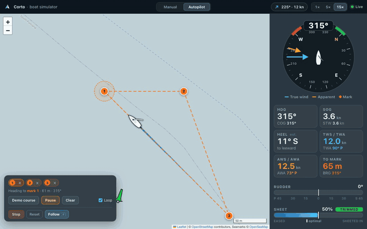

# Corto simulator

The test bench behind the Corto web app's `--source sim`. The app itself shows the real boat over LoRa (see the main README); with `--source sim` it shows this simulator instead, labelled **Simulator** in the header. The simulator runs a small sailing-physics model behind the same Flask app and sailing-instrument UI, and it can sail a course of marks with **the boat's own `Navigator`** (`src/main/python/boat/navigation/navigator.py`) steering the simulated rudder and sheet, so the app and the navigation code can be exercised without a boat.



## Run it

```bash
python -m venv .venv && source .venv/bin/activate
pip install flask ultraimport            # the simulator needs nothing else (pytest for the tests)
python src/main/python/app/app.py --source sim --port 5000 [--host 127.0.0.1]
```

(`--source auto`, the default, picks the simulator on any machine without the LoRa radio libraries. `--source boat --radio loopback` puts this simulator behind a fake radio so the app's boat mode can be developed without hardware.)

Open <http://127.0.0.1:5000>. (On macOS port 5000 is often taken by AirPlay Receiver: pick another with `--port`.)

**Demo:** <http://127.0.0.1:5000/?demo=1&warp=15> resets the boat, loads the demo course, starts the autopilot, follows the boat at zoom 18 and hides the hints. With wind from 225 degrees at 12 knots the autopilot rounds the three marks after about 14, 20 and 34 seconds at 15x (add `&scale=1` for the 1x-size course: about 10, 14 and 22 seconds).

URL parameters: `demo=1`, `warp=N` (1..30), `scale=S` (demo course size, default 1.5), `zoom=N`, `follow=1`, `hints=0`. `demo`, `warp` and `scale` are the simulator's and are ignored when the app shows the boat.

## The UI

| Area | What it is |
|---|---|
| Top bar | A **Simulator** badge next to the name (with the real boat it reads "Boat · LoRa"), the **Manual / Autopilot** switch (**Course** with the boat), a wind chip that opens the environment popover (wind speed and direction, current speed and direction; changes apply live), **1x / 5x / 15x** time warp, and a live dot. |
| Map | OpenStreetMap, muted so the boat and course stand out, plus the OpenSeaMap seamark overlay and a metric scale bar. The boat is a persistent SVG hull rotated with a CSS transform, with its boom swung to leeward by the sheet setting. The wake is about 90 s of sim time drawn as a fading polyline. |
| Instrument rail | A 240 px heading-up wind/compass dial (true wind in cyan, apparent wind in amber, red/green close-hauled sectors, an orange tick for the bearing to the active mark), tiles for HDG, SOG, HEEL (est.), TWS/TWA, AWS/AWA and distance/bearing to the mark, a centred **rudder bar** (+/-45 degrees, red to port, green to starboard) and a **sheet bar** with an optimal-trim marker and a state word (TRIMMED / LUFFING / OVER-TRIMMED). |
| Control dock | Manual: rudder slider (-100..100, double-click to centre), sheet slider with the optimal marker and an **Auto-trim** checkbox, a collapsed motor slider. Autopilot: click the map to add marks, drag a mark to move it, mark chips with an x, **Demo course**, **Start / Pause**, **Clear** and a **Loop** toggle. **Stop** centres the rudder, zeroes the sheet and motor, and switches to manual. |

Keyboard: left / right arrows change the rudder by 10, up / down change the sheet by 5, **F** toggles the follow camera.

Dashed lines are the course. A leg that points closer than 45 degrees to the wind is drawn **red** with the tooltip "Upwind leg: navigator can't tack yet".

## How it works

```
 browser  <--- 10 Hz poll of GET /api/state, POST /api/control ...  --->  app/app.py (Flask, create_app(source))
                                                                            |
                                              app/sources.py: SimSource  (or BoatSource in app/boat_link.py: LoRa)
                                                                            |
                                                         simulator/simulator_integration.py
                                                                            |
        simulator/autopilot.py  --- Navigator.compute_boat_attitude ---> simulated servos
                                                                            |
        simulator/simulator.py  <--- rudder / sheet / throttle ----------  BoatPhysicsSimulator (background thread)
```

* `simulator.py` has the simulated wind vane, GPS, servos and nav-params recorder (they implement the same methods the real drivers do) and `BoatPhysicsSimulator`.
* `autopilot.py` has `Course` (marks, active mark, loop, 15 m arrival radius, upwind flag, demo triangle) and `SimAutopilot`, which feeds the Navigator the simulated sensors and applies its attitude to the servos exactly like `Corto.run_loop` does on the boat. Modes: manual, manual + auto-trim (the Navigator trims the sheet, you steer) and autopilot.
* `simulator_integration.py` validates and clamps everything that comes from the network; bad input is a 400, never a 500.
* `app/sources.py` wraps all of this as `SimSource`, one of the two sources the app can show. `STATE_KEYS` lists the keys `/api/state` always has; the real boat's `BoatSource` serves the same keys with `null` for what its LoRa protocol does not carry.

### Conventions

* Rudder servo: Percent **0 = full left, 50 = centre, 100 = full right** (the real boat's `RudderPosition`). Physics and the UI use the signed value `(pct - 50) * 2`, -100..100; positive is starboard and makes the heading increase. The rudder angle shown is the signed value x 45 degrees.
* Sail servo: 0 = eased, 100 = sheeted in. The Navigator asks for 100 at 45 degrees to the wind and 0 at 135 degrees.
* Wind direction is where the wind comes **from**; current direction is where the water flows **to**. True and apparent wind angles are positive when the wind comes over the starboard side.

### Physics model

Constants are at the top of `simulator.py`.

| Part | Model |
|---|---|
| Time | The simulation runs `SIM_TIME_SCALE = 15` times faster than the clock (1..30, set by the warp buttons), in sub-steps of at most 0.4 s; the autopilot runs before every sub-step. |
| Drive | `tws x polar(twa) x trim_match x 0.4` knots. The true wind angle is folded to 0..180 degrees so both tacks work; `polar = 1 - abs(twa - 120) / 120` and zero below `NO_GO_DEG = 30`. `trim_match = max(0, 1 - abs(trim - optimal) / 60)` where `optimal` is the Navigator's own mapping (45 degrees -> 100, 135 degrees -> 0). The motor adds up to 5 knots. |
| Momentum | Boat speed relaxes to its target with `MOMENTUM_TAU_S = 8` s. |
| Steering | `TURN_DEG_S_AT_5KN = 12` degrees per second at full rudder and 5 knots, proportional to rudder and speed, with a floor of `MIN_STEERAGE_KN = 0.6` so a stalled boat can still turn. |
| Position | In metres with a cos(latitude) correction: `dlat = v dt / 111320`, `dlon = v dt / (111320 cos(lat))`. The current is added to give SOG and COG. |
| Apparent wind | `apparent_wind(tws, twd, stw, hdg) -> (aws, awa)` by vector subtraction. |
| Heel | An estimate, `min(30, 0.15 aws^2 abs(sin awa) trim / 100)` degrees to leeward. It is labelled "est." because it is not a hydrodynamic model. |

The default start is `DEFAULT_START = (43.6545, -70.2230)` (open water in Casco Bay, ME) on heading 315.

### No tacking yet

The Navigator steers straight at the active mark. A mark that is (nearly) upwind cannot be reached without tacking, so the boat ends up in irons. Upwind legs are **flagged and warned about, not handled**. Tacking is future work.

## HTTP API

| Endpoint | |
|---|---|
| `GET /api/state` (alias `/api/boat-location`) | Telemetry (`heading cog sog stw tws twd twa aws awa heel rudder rudder_deg trim opt_trim throttle drift lat lng ...`), `mode`, `running`, `auto_trim`, `time_scale`, the `course` (marks, active mark, legs with an `upwind` flag) and `to_mark`. Plus `source` (`"sim"` here, `"boat"` for the real boat), `link` (`{kind, state, age_s, fix, rssi, polls, replies}`; for the simulator always `state: "ok"`), `capabilities` (what the UI may offer: `manual auto_trim mode course run_course demo environment time_scale reset`, all true here) and `commanded` (`null` here). The keys are the same in both modes; the boat reports `null` for what its protocol lacks. |
| `POST /api/control` | `{command, value}` with `rudder` (-100..100), `sails` (0..100), `throttle` (0..100), `emergency_stop` or `set_environment`; and/or `{mode: "manual"\|"auto", running, auto_trim, time_scale}`. Numbers are clamped. With the real boat only `rudder`, `sails`, `throttle`, `emergency_stop` and `running` exist; `mode`, `auto_trim`, `time_scale` and `set_environment` answer **409**. |
| `POST /api/course` | `{marks: [{lat, lng}], loop?, active?}` replaces the course. `DELETE /api/course` clears it. |
| `POST /api/course/demo` | `{scale?}` lays the demo triangle out from the boat and rotates it to the wind. 409 with the real boat. |
| `POST /api/reset` | `{lat?, lng?, heading?}` puts the boat back at rest with neutral controls. 409 with the real boat. |

## Tests

```bash
pip install pytest && pytest
```

`src/test/python` covers the Navigator (right gives more than 50, left gives less than 50, a 1 degree deadband, proportional response, sail trim unchanged), the physics (port and starboard beam reaches match, the rudder turns both ways, no drive below 30 degrees, 100 m east is 100 m by haversine, apparent wind), the course (marks advance, the course loops, upwind legs are flagged), the autopilot lap, the HTTP API, and the real-boat link (`test_boat_link.py`: wire format, polling, link states, commands, the 409s, and the loopback boat).

## Limitations

* No tacking (see above), and no obstacles or land: the boat can sail over islands.
* One uniform wind and current for the whole map. The physics is simplified on purpose; use it to exercise the navigation code, not to predict boat speed.
* The real boat's rudder direction (which way the servo moves for a given `RudderPosition`) must be bench-tested before the fixed Navigator runs on hardware.
